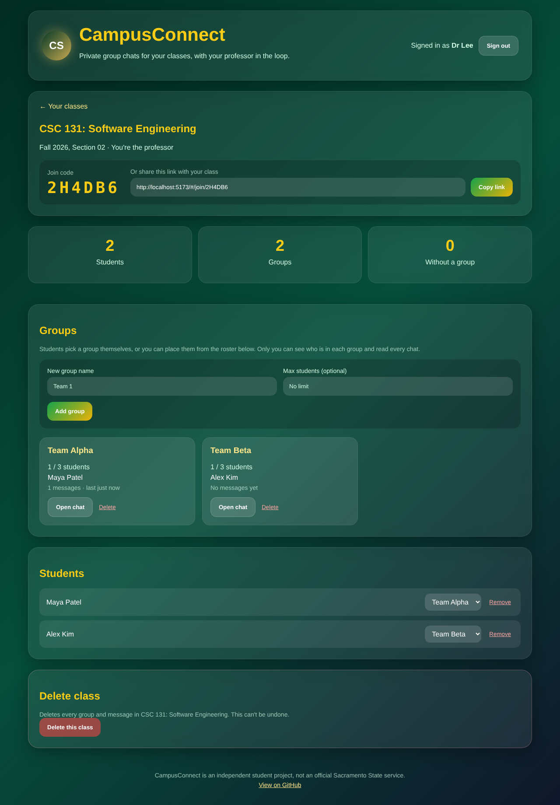
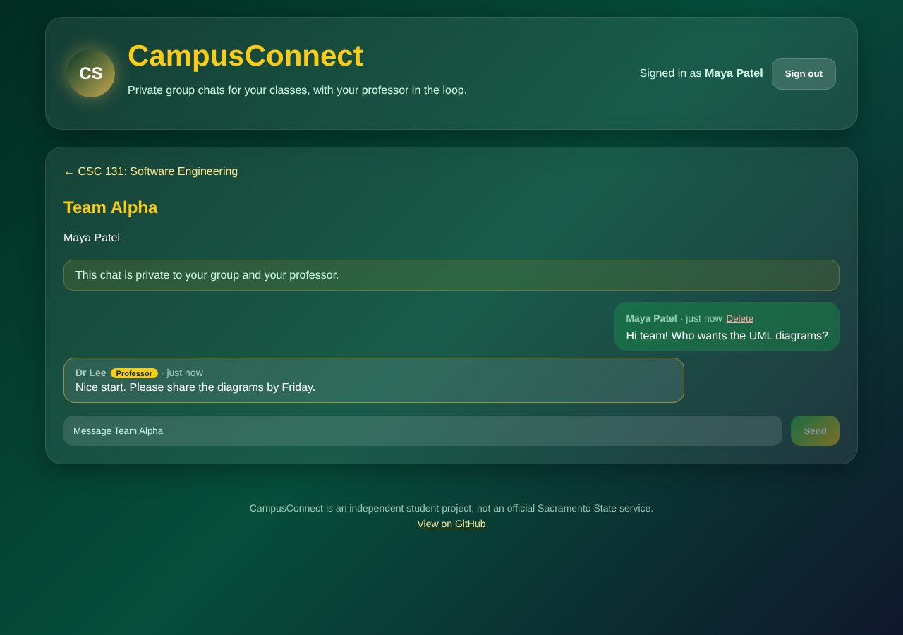

# CampusConnect

[](https://github.com/Rakibul475/CampusConnect/actions/workflows/ci.yml)

Private group chats for your classes, with the professor in the loop.

A professor creates a class and shares a join code. Students sign in, join the class, and pick a group. Each group gets its own chat. Only the professor can see who is in every group and read every discussion.

**Live site:** https://campus-connect-two-theta.vercel.app



> CampusConnect is an independent student project inspired by Sac State. It is not an official Sacramento State service.

## How it works

**Professors**
- Create a class and share its 6-character join code or invite link.
- Add groups, with an optional size limit.
- See every student, which group they're in, and move or remove them.
- Open any group's chat, read the discussion, post as the professor, and delete messages.

**Students**
- Sign up with their name and email, then join with the code or link.
- Pick a group (or get placed by the professor).
- Chat with their group in real time. They see only their own group's members and messages.



## Privacy

Access is enforced by the database, not just the website, using Supabase row-level security ([`supabase/migrations`](supabase/migrations)):

| | Professor | Student in the group | Other students in the class |
|---|---|---|---|
| Group names and sizes | ✓ | ✓ | ✓ |
| Who is in the group | ✓ | ✓ | ✗ |
| The group's messages | ✓ | ✓ | ✗ |
| Class roster | ✓ | ✗ | ✗ |

The rules are covered by tests in [`supabase/tests`](supabase/tests).

## Tech stack

- [React 19](https://react.dev) and [Vite](https://vite.dev)
- [Supabase](https://supabase.com): auth, Postgres with row-level security, realtime
- ESLint and Vitest, run on every push by GitHub Actions
- Deployed on [Vercel](https://vercel.com)

## Set it up

See [docs/SETUP.md](docs/SETUP.md) to create the Supabase project and connect the site. Then:

```bash
git clone https://github.com/Rakibul475/CampusConnect.git
cd CampusConnect
cp .env.example .env.local   # add your Supabase URL and anon key
npm install
npm run dev
```

| Command | What it does |
|---|---|
| `npm run dev` | Start the dev server with hot reload |
| `npm run build` | Build for production into `dist/` |
| `npm run lint` | Run ESLint |
| `npm test` | Run the unit tests |
| `npm run test:db` | Check the database access rules against a Supabase project |

## Roadmap

- [ ] Sign in with a school Google or Microsoft account
- [ ] Professor announcements to the whole class
- [ ] Notifications for new messages
- [ ] Share files in group chats
- [ ] Export a group's discussion for grading

## Contributing

Ideas and bug reports are welcome. Open an [issue](https://github.com/Rakibul475/CampusConnect/issues) or a pull request.

## Author

Built by [Md Rakibul Islam Rifath](https://github.com/Rakibul475).
